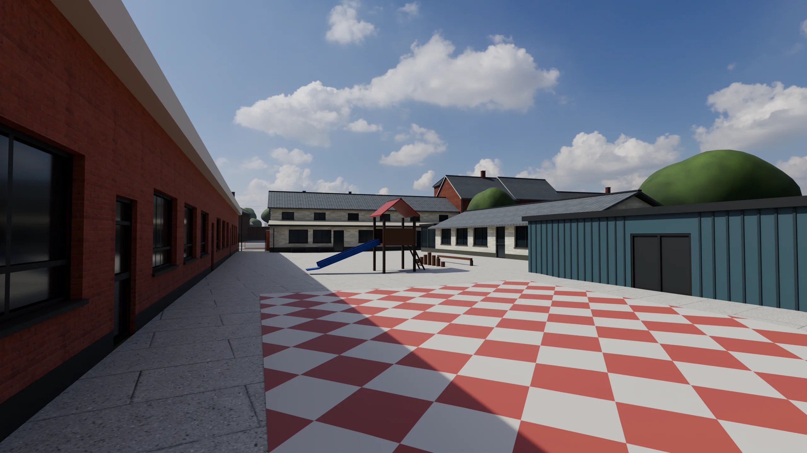
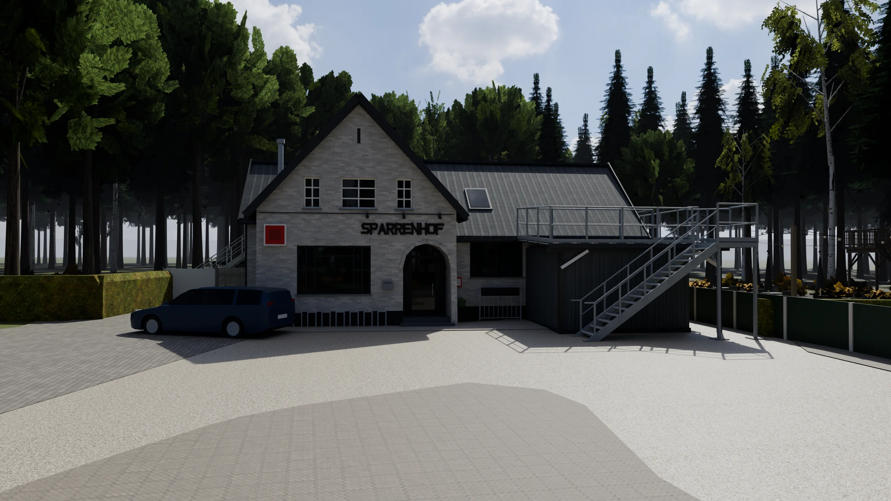

# Brieltje

Smetlede and Briel in 3D: a walkable model of the village of Smetlede (Lede, Belgium) and the hamlet of Briel, from the church square and the school to Molenhoek, the fields and our own house. It runs in the browser: explore it alone, or with friends in multiplayer. It is a work in progress, and more of the village is added all the time.

**Play it at [brieltje.be](https://brieltje.be).** Fancy playing together in person, or having your own house in the game? [Let us know](https://brieltje.be/interested). Best on a laptop or desktop with a keyboard and mouse or a PS5 DualSense. Phones and tablets get touch controls. brieltje.be is open to visitors in Belgium only. To play from elsewhere, email yoshi@brieltje.be, or run it yourself (below).


For in-person play, [express interest](https://brieltje.be/interested/) or [check game night registration](https://brieltje.be/inschrijven/).

During play, open the menu’s Controls tab for a quick guide or to switch between a connected controller and the keyboard.

At a portal, use 1–8 on the number row or numpad to pick a destination.

The village square's paving follows the ground under it.

In team games, press V to mark your position for teammates for eight seconds; the shortcut is listed in Controls without a permanent HUD hint. Touch players tap **Come here**. Markers show their distance and direction. While holding an equipment action in Zombies, a green preview shows where it fits. The break between waves highlights rewards nearby and gives you time to reload and prepare.


The whole project was made with AI. Yoshi Parlevliet, a cybersecurity consultant rather than a game developer, directed development and used both [OpenAI Codex](https://openai.com/codex/) and [Claude Code](https://claude.com/claude-code) to build the game, the data tools and the Blender scripts. Every choice and the reason for it is in [DECISIONS.md](DECISIONS.md).

## Recent updates — 11 November 2026

- **LAN nights.** Up to 32 players at once. Double-click `lan.cmd` to host on your own computer in Docker: it asks for an admin password, and players type https://lan.brieltje.be (Caddy in front of the game, with a real certificate; `lan.cmd -Http` for plain http on the computer's address). Watch players on `/admin/watch/`: one, or up to four side by side, to put on a projector. The host runs the evening from `/admin/host/`: lock the doors, announce on every screen, freeze everyone, bring players to you, mute, a word filter, teams for the evening, a programme of games with a countdown, and tonight's scoreboard per player and per team, also on the big screen.
- **Grass and leaves.** Thin blades of grass round you, at the height the place asks for: none on the football pitch, a few centimetres on lawns and verges, taller clumps in the pastures, shin-high along fields and ditches. Fallen autumn leaves under the trees (Medium and up).
- **Worn roads.** Repair patches, tar-sealed cracks and the seam down the middle of the asphalt streets.
- **Streets that look used.** Silt in the gutters, kerbstones with joints, rust-brown drains. Earth and grass creep over the edges of roads, pavements and drives. Molenhoek has its light concrete edging beside the red cycle lanes.

## Recent updates — 8 November 2026

- **A new start screen.** Three short steps: who you are (a guest with a ready name, or your account), alone or together, then the game and where to start. Zombies is suggested first. "Play again as before" starts the same game in one press, and shows its own loading bar. It works on a desktop, a tablet and a phone, upright or held sideways.
- **For console players.** With only a controller, the start screen moves into a pad mode: a big focus ring, the buttons' names along the bottom, and no mouse pointer on an Xbox. Log in by scanning a QR code with your phone and typing the two-digit number shown on the TV.
- **A playful new look.** The colours of our game-night poster and the rounded Fredoka font, in the game, the menu and the website, with a new logo: a roof with two lit windows over the name.
- **The football ground.** FC Smetlede's ground east of the village, our own Blender model: the pitch, full-size goals with nets, the floodlights, the canteen and the car park. A youth training runs on it, with a coach, a keeper and parents at the rail. The street now runs all the way there, as on the real map.
- **The Sparrenhof for Zombies.** Start a Zombies game at the café: the horde comes out of the wood. Steel stairs lead onto the roofs, an upper deck and a walkway, and four tree huts in the wood are shooting bases up timber stairs. Sniper rifles lie on the church's roof walk and on the Sparrenhof's roof.
- **Zombies on the ground.** Zombies starts on foot at its place, alone or together, never by parachute. Clowns and strongmen stay out of the way while it runs.
- **Driving.** Tyres grip by the ground they're on, with ABS and a handbrake (Space or ✕) that locks the rear wheels for a slide. The camera looks into a turn, and the tyres screech by how much they slip. Cars knock over letterboxes, posts, bins and bikes along the street.
- **Rain you can see.** Streets darken, shine and hold puddles that mirror the street, then dry over minutes. Windows mirror the sky and the street, with raindrops running down. Wheels throw spray on a wet road.
- **Real trees.** On Medium and up, trees, conifers, hedges and the wood's undergrowth are built from leaf cards, with bark, branches and cut-out shadows.
- **The street, closer to life.** Traffic signs and bus stops stand where they really are, drawn as the Belgian rules draw them. A few grey and green wheelie bins, built from their published sizes. Paving, gravel, kerbs and verges meet cleanly, and no two surfaces flicker on each other anywhere on the map.
- **A town board.** On the church square, a notice board shows the best Zombies runs behind its glass.
- **Fewer villagers in the side streets.** The church square stays busy, the other streets are quiet.
- **Accounts.** Type a home's code once while logged in, and your account keeps access to that home. A guest's good Zombies run can be kept by making an account straight after.
- **Aim assist.** A subtle one for controller players, against zombies only.
- **Weather** now changes every 10 minutes.
- **Faster and lighter.** The game loads in about 6 seconds on a desktop, uses less memory, and stays smooth on slower graphics chips.

## Recent updates — 7 November 2026

- **Weather and time of day.** The sky now changes by itself, slowly: sunny, overcast, rain and night, each for about 10 minutes, blending over a minute. Rain falls round you but not indoors, and the roads turn dark and shiny. At night the street lamps glow and about half the village's windows light up. Alone you can fix a mood in Settings (Weather); together the admin picks it for everyone, skips to the next weather or speeds the cycle up.
- **Houses with their own look.** Every house from the open data has its own shade of brick or render, its own roof tiles and frames, and a room behind each window: walls, a floor, furniture and curtains.
- **The ground, the horizon and the trees.** Yards and gravel round the houses are weathered paving instead of flat pale patches. The horizon is a low, hazy band of tree lines. Tree crowns have leaf clusters and lighter undersides, and the wood by the Sparrenhof has fallen leaves, ferns, brambles and shrubs.
- **Cars that feel heavy.** The body leans in corners, dips when braking and bumps over kerbs; the tyres leave skid marks and the motor whines with the speed.
- **Zombies that fall.** A beaten zombie goes limp and falls the way the shot pushed it, against walls and down stairs. Nothing more: no blood.
- **New guns and hands.** All five guns and the gloved hands are our own models now. The pistol's slide kicks back, the shotgun is pumped, the sniper's bolt is worked, and every reload is done by hand.
- **Arms that look like arms.** The sleeves are the sculpted model's own forearms, with straight wrists, coming up from the bottom of the picture. The gun is drawn with a narrower view at the hip, as shooters do, and no longer pokes through a wall you stand against.
- **Sound with room.** Houses and the church tower echo, and the outdoors sounds muffled when you're inside. The bells ring loud in the tower.
- **A calmer menu.** The settings are grouped (display, sound, weather, on screen, moving and looking, language and keyboard), and only what applies to the way you play is shown. A small Beta mark replaces "Work in progress".
- **Bikes.** Thirteen city bikes stand by the main house, at the bungalow and in racks at the portals. Get on with Use, pedal up to 25 km/h (slower uphill, faster downhill), lean into the corners and ring the bell.
- **Football.** A ball and two small goals on the school's playground, and a ball on the back lawn. Walk into it to dribble, press Use to kick. Together, the server keeps the ball, so everyone sees the same game.
- **Villagers.** Invented villagers walk the pavements, cycle the red lanes, walk their dogs, chat and wave. Everyone sees the same ones in the same place. In Action a shot fells one for 40 seconds: a cartoon tumble, no blood, no points. In Paintball the paint sticks to their clothes. Never a child, a dog, a parent with a child or anyone at the school. In Zombies they are gone.
- **Water.** Wade through ditches, swim in the ponds, splash, and watch the rain ring the water.
- **New start pictures.** Smetlede at night, Molenhoek in the rain, and a parachute over the church square at dusk.
- **Dusk and snow.** Two more weather moods: a low golden sun turning into blue hour, and snow that whitens roofs and fields (on Auto only in winter, and rarely).
- **Shadows and glow.** On Medium and up, people, cars and bikes cast shadows wherever you are, and lamps, lit windows and portals glow softly at night.
- **The school's slide.** Climb the play tower's ladder, stand on the platform and slide down.
- **Sint-Maarten and Sinterklaas.** In Explore, Sint-Maarten rides on the church square from 4 to 11 November, with lanterns and carrots on his evenings; Sinterklaas follows from mid-November to 6 December. From Advent to Epiphany the square has a Christmas tree and lights hang along the eaves.
- **Other controllers.** Xbox-style and Nintendo-style controllers get their own button names, and the map and scores sit on the View button. The 8BitDo Ultimate 2C works over its 2.4G dongle.
- **Split screen.** brieltje.be/splitscreen puts two to four players with their own controllers on one PC, each joining the game together.

## Recent updates — 6 November 2026

- **Faster Teslas, with a speedometer.** Both models now reach about 200 km/h with gradual acceleration. All four wheels roll correctly, including the mirrored left side. A compact km/h readout appears while driving or riding along; on touch screens it sits below the map.
- **The southern homes.** The map continues along the roads and lanes to Oordegemkouter, with 80 additional buildings and their real terrain. A detailed pale-brick house has a tall glazed entrance, hipped roof with solar panels, gravel driveway, clipped hedges and trees. Its exterior and garden are our own Blender model; the doors stay shut. Use `/location Oordegemkouter` and follow the street to reach it.
- **Skydive in.** You arrive from 170 m up, seen from behind your own skydiver: steer in free fall, dive head first, open your parachute yourself (it opens by itself at 45 m) and glide down to any spot inside the game. Fresh starts and respawns after a death come in this way (Zombies starts on the ground), and `/parachute` in the chat jumps on demand (outside, once a minute together). In Zombies a wave waits until everyone has landed. In multiplayer the server decides every drop and its speeds.
- **The Sparrenhof.** The map now runs up Oud-Smetlede to the café Sparrenhof at the edge of the wood, with a portal on its forecourt (`/sparrenhof`). The café is our own detailed Blender model; the houses on the way come from the open data.
- **The church square from new photos.** The church's white west door, the calvary chapel by the tower, rough sandstone corners, the flags and the memorial stones; the houses round the square corrected one by one. The gate behind the church portal stands open.
- **Baked light.** The village's own building models carry light worked out in Blender's Cycles with the whole village round them: shade under eaves and between houses, bounced light, the sun's shadow across the village, and some dirt and rain streaks. The houses at home get theirs behind the loading screen.
- **Lighter on graphics memory.** Textures are GPU-compressed (KTX2): about a quarter of the memory on desktops, and on phones the half-size set (5.5 MB).
- **Small things.** Garden fences can be jumped over. The main house's front has a dark panel between the two windows over the door, and no more dark lines under the sills.





## New: Zombies


The newest game in Brieltje (November 2026). Zombies come in waves, from every side and always out of sight. Each wave is bigger, a little faster and a little tougher than the last. The waves never end: how far do you get? Play it alone from the menu's Play tab (your best wave is kept), or together when the admin starts it for everyone. Pick where: at home round the house and the bungalow, or by a portal in Smetlede (the church square, one of three spots along Molenhoek, or the Sparrenhof by the wood). The game's edge closes round that place while it runs.

- **Five zombies**, our own Blender models, rigged and animated: a thin one in a torn shirt, a teen in a red hoodie, an old mechanic in overalls, a farmer in wellies, and a big one in a white vest. From wave 3 the hoodies sprint. Every fifth wave brings big ones, who stomp and pound the ground round them.
- **No safe room.** Together the houses are open, and the zombies follow you in: up the stairs, onto the roof terrace, through the doors. A shut door holds them for a moment. Whoever perches where no zombie can reach is warned, and then out of the wave.
- **Church roof.** Enter the open doors beneath the tower and follow the hidden spiral stair to the roof walk. A steel rail guards the stair edge and the upper landing, with a clear doorway onto the roof. Three firing bays give a view over the square, with partial cover. Zombies, including the big ones, can follow you up. The route is open in solo play and multiplayer.
- **Helping each other up.** A teammate who is down gets up again when you hold Use (E or △) next to them for 3 seconds.
- **Rewards.** Beaten zombies sometimes drop one: a bigger ammo pack, a scope for the rifle and the pistol, or a claymore (hold G or R1 to place it).
- **More rewards.** A first-aid kit (+50 health), an armour vest that takes the next 50 damage, three extra grenades, a supply crate with a long gun you don't have yet, and a music box: zombies near it shuffle slowly for ten seconds.
- **Stakes.** A big one also drops a bundle of wooden stakes. Hold R (□ on the controller) to plant a row in front of you. Zombies wade through it slowly, and it wears out after about ten of them. A row works best in a gate, a doorway or on a stair. Players on foot can go around either end or cross once the row breaks.
- **Turret.** A big one drops a turret too. Hold E (△) where there is nothing else to use, and it goes up in front of you. It shoots the nearest zombie it can see until its 100 rounds are gone, about half a minute of firing, then folds away. It is a helper, at about a sixth of a rifle's damage.
- **The sniper's double.** One bullet can go through two zombies.
- **Sound.** They groan more often and louder as they come closer, from where they stand. A sprinting runner puffs.
- **Fair.** In multiplayer the server decides every hit, swipe, pickup and help.
- **Keep going.** There is no wave limit: the game continues while a fighter is still standing. Brief connection drops have a 15-second reconnect grace instead of resetting the match.
- **Admin wave control.** During Zombies, alone or together, open the menu's Admin tab to switch immediately to any wave from 1 to 9999, higher or lower. It replaces the zombies and brings downed teammates back while keeping your gear. These custom runs do not replace best-wave records.


## What's in it

| | |
|---|---|
| **Smetlede** | The village centre as our own Blender models: the Sint-Pharaïldis church, the café beside its tower, the primary school with the chip shop by it, and the houses round the church square. Molenhoek from the church square to its end at Oordegemkouter, on the street as it was rebuilt in 2026, and Kapellenhoek to past Briel: more than 180 houses of our own. At Molenhoek's end you can walk into the end house of the new terrace. The village also includes a custom brick dormer house, up Oud-Smetlede the café Sparrenhof at the edge of the wood, with its forecourt and terrace, and east of the village FC Smetlede's football ground. You start on the church square, or at another portal of your choice. |
| **Briel** | The hamlet between the fields: the houses along Briel, the bungalow, and the farms and meadows round them. |
| **Everything else** | Built from Flemish open data (GRB, the DHM laser scan, the orthophoto): some 1,400 buildings with their roofs, roads, fields, hedges, trees, poles and ponds, on the real relief. The roads, houses and alleys continue up to about 400 m farther east, along Oud-Smetlede through the wood to the Sparrenhof, and south to the homes on Oordegemkouter. Facades follow a Street View survey (used as a reference only). |
| **Our house** | Real scale, seen from outside. Its inside opens only with a code. Spawn more with a name in the chat: /sofa, /tesla red, /clown (together when the admin allows it). |
| **Life** | Birds that fly off when you come near, a robot mower doing its rounds, cows and sheep in the meadows, trees in the wind, cars on the roads, and church bells striking the hours. |
| **Getting around** | Walk, sprint, fly, drive a Tesla (with a passenger) or ride a horse. Eight portals jump between our house, the bungalow, the church, the school, three places along Molenhoek and the Sparrenhof. `/location` in the chat, or the menu's Play tab, takes you to any portal or to 36 streets. You arrive by skydive, and `/parachute` jumps again. The map (M, the menu's first tab) gives directions along the roads. |
| **Ways to play** | Explore (just walking around), Paintball (paint guns, for everyone) or Action (a pistol, then a rifle, a shotgun, a sniper rifle and grenades, against each other, giant strongmen and clowns; no shooting on the school grounds). |
| **Together** | Up to 16 players, as a guest with just a name or with an account of your own. Chat, party games (hide and seek, tag, a treasure hunt, Zombies), and house against bungalow. Zombies rooms: a player with an account opens one, anyone joins, and the open world plays on. A board of the best Zombies runs (accounts only), a leaderboard, and a scoreboard to project at a meetup. |
| **Anywhere** | Graphics presets with auto-detection, keyboard and mouse, controller, or touch. In English or Dutch (Nederlands), chosen on the start screen or in the settings. Key hints follow an AZERTY or QWERTY keyboard. |

## Private homes

Three homes in the game are locked on the inside: our house, the bungalow and the end house at Molenhoek. You can walk round all of them. To go in, you type the home's access code at the door.

- **The outside is public.** It is in this repository and in the game for everyone.
- **The inside is not.** The game files hold only the outside. The inside is stored encrypted (X25519 and AES-256-GCM) in `web/private/*.enc`. Only the production server holds the key, as a Railway variable. This repository can't open those files.
- **A code belongs to one home.** The admin makes it on the Homes tab and sees it once. The server keeps only a scrypt hash of it, plus counters of right and wrong tries, without names or IP addresses. A right code lets your session in for 8 hours. The admin can revoke a code or make a new one at any time.
- **The server decides.** It sends a home's inside, its furniture, its door states and its broken panes only to players who typed the right code (and to the admin).
- **New homes are private by default.** A neighbour who wants their home in the game gets the same lock. The inside is public only if the owner explicitly chooses that on the interest page. The owner can change the choice at any time through their own link.

More in the [privacy policy](web/public/legal/privacy.html) and under "Private data" in [docs/DETAILS.md](docs/DETAILS.md).

## Screenshots

| | |
|---|---|
|  |  |
| The house from the lane | The back garden, with the robot mower doing its rounds |
|  |  |
| The café beside the church tower | The church of Smetlede from its square |
|  |  |
| The primary school's playground, with covered bike stands by the gate | Cows in the meadows round the house |
|  |  |
| A portal on the church square | The map, the menu's first tab: Smetlede round the church |
|  | |
| Molenhoek, rebuilt in 2026 | |
|  | |
| On a phone, at a portal | |

## Controls

| Action | DualSense | Keyboard and mouse |
|---|---|---|
| Move, look | Left stick, right stick | W A S D (Z Q S D on AZERTY), mouse |
| Sprint, jump | L3, ✕ | Shift, Space |
| Fly up / down | Hold ✕ / ○ | Hold Space / Ctrl |
| Use (doors, cars, horses, portals) | △ | E |
| Map (the menu's first tab) | Press the touchpad | M |
| Shoot, aim (Action, Paintball) | R2, L2 | Left click, right click |
| Throw a grenade; hold to place a claymore (Zombies) | R1 | G |
| Reload; hold to plant a row of stakes (Zombies) | □ | R |
| Set up a turret (Zombies) | Hold △ | Hold E |
| Help a teammate up (Zombies) | Hold △ for 3 s | Hold E for 3 s |
| Free fall: steer, dive | Left stick, hold ○ | W A S D (Z Q S D), hold Ctrl |
| Open your parachute | ✕ | Space |
| Drive: gas, brake, steer; handbrake | R2, L2, left stick; ✕ | W, S, A D; Space |
| Menu | Options | Esc |

Every control is listed in the game's menu (Controls), and in [docs/DETAILS.md](docs/DETAILS.md).

## Run it yourself

You need Node.js 22 or newer.

```
cd web
npm install
npm run dev
```

Open http://localhost:5173. That's solo play. For multiplayer, build and start the server with an admin password of your own:

```
npm run build
ADMIN_PASSWORD=choose-one npm start
```

It listens on http://localhost:8080. Without `DATABASE_URL` (Postgres) it keeps its players in `web/.data/`.

Pick Together on the start screen: play as a guest with a name, or make an account. The **Admin** link logs you in with your admin password. The players' accounts are on http://localhost:8080/admin.

## How it's made

- **The game:** Three.js (WebGL) in TypeScript, built with Vite. A small Node server with WebSockets runs multiplayer, and the server checks every move, shot and trip. In Zombies it also runs the horde: a grid of the ground and the houses' floors, a distance field the zombies walk down, and every hit and swipe.
- **The world's data:** Python and Blender scripts in [`tools/`](tools) turn the open data and our own measurements into `web/src/data/*.json` and `web/public/models/*.glb`. Private source files are not in this repository; what the game needs is already built.
- **Performance:** the graphics chip is the limit, so most things are instanced, animated in shaders and hidden beyond a draw distance. On the development PC a frame takes about 10 to 15 ms at Medium.
- **Light and textures:** the building models of our own carry light baked in Blender's Cycles with the whole village round them, and wear (dirt, streaks, green). Textures are GPU-compressed (KTX2, Basis Universal), half size on phones.
- **Security:** scrypt password hashes, `__Host-` cookies, same-origin checks, rate limits, and the server deciding every hit and trip. Cloudflare sits in front.
- **More:** [docs/DETAILS.md](docs/DETAILS.md) (features in depth, hosting, rebuilding the data, the folders), [DECISIONS.md](DECISIONS.md) (every decision and why) and [PROGRESS.md](PROGRESS.md).

## Contributing

Contributions are welcome. Bug reports, fixes, performance work, accessibility, translations and new details of the villages all help. Open an issue first for anything big. Only Yoshi merges, after a review. `main` goes live on brieltje.be.

Read [CONTRIBUTING.md](CONTRIBUTING.md) before you start. It has the setup, the checks and the rules on privacy, assets and security.

## Licence

© 2026 Yoshi Parlevliet. This project is licensed under [Creative Commons Attribution-NonCommercial 4.0](LICENSE) (CC BY-NC 4.0).

- **You may** use, copy, share and adapt it, for any non-commercial purpose.
- **You must** credit Yoshi Parlevliet, with a link to this repository, and say if you changed it.
- **Commercial use** needs written permission.

Playing on brieltje.be is subject to the [terms of use](https://brieltje.be/legal/terms.html) and the [privacy policy](https://brieltje.be/legal/privacy.html) of Yoshi Parlevliet CommV (contact: yoshi@brieltje.be).

Third-party assets keep their own licences: the textures, sky and characters are CC0, and the map data is © Digitaal Vlaanderen under its free reuse licence. See [docs/CREDITS.md](docs/CREDITS.md).
