# Brieltje

Smetlede and Briel in 3D: a walkable model of the village of Smetlede (Lede, Belgium) and the hamlet of Briel, from the church square and the school to Molenhoek, the fields and our own house. It runs in the browser: explore it alone, or with friends in multiplayer. It is a work in progress, and more of the village is added all the time.

**Play it at [brieltje.be](https://brieltje.be).** Fancy playing together in person, or having your own house in the game? [Let us know](https://brieltje.be/interested). Best on a laptop or desktop with a keyboard and mouse or a PS5 DualSense. Phones and tablets get touch controls. brieltje.be is open to visitors in Belgium only. To play from elsewhere, email yoshi@olive-security.be, or run it yourself (below).

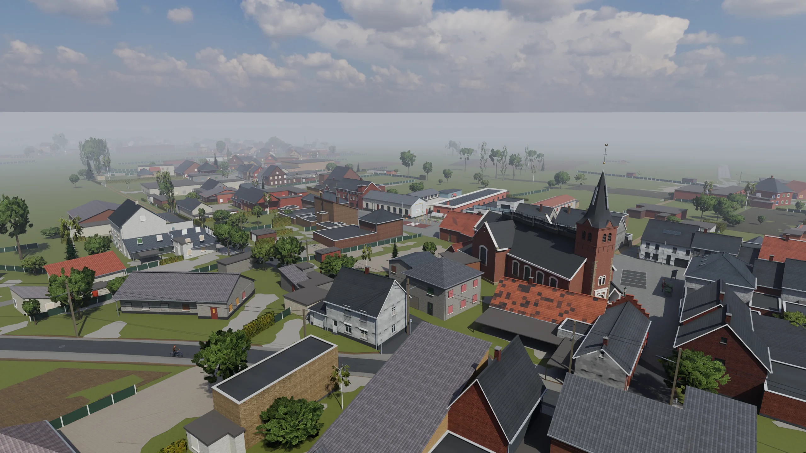

For in-person play, [express interest](https://brieltje.be/interested/) or [check game night registration](https://brieltje.be/inschrijven/).

During play, open the menu’s Controls tab for a quick guide or to switch between a connected controller and the keyboard.

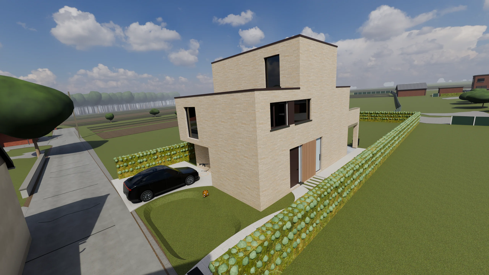

The whole project was made with AI. Yoshi Parlevliet, a cybersecurity consultant rather than a game developer, directed development and used both [OpenAI Codex](https://openai.com/codex/) and [Claude Code](https://claude.com/claude-code) to build the game, the data tools and the Blender scripts. Every choice and the reason for it is in [DECISIONS.md](DECISIONS.md).

## New: Zombies

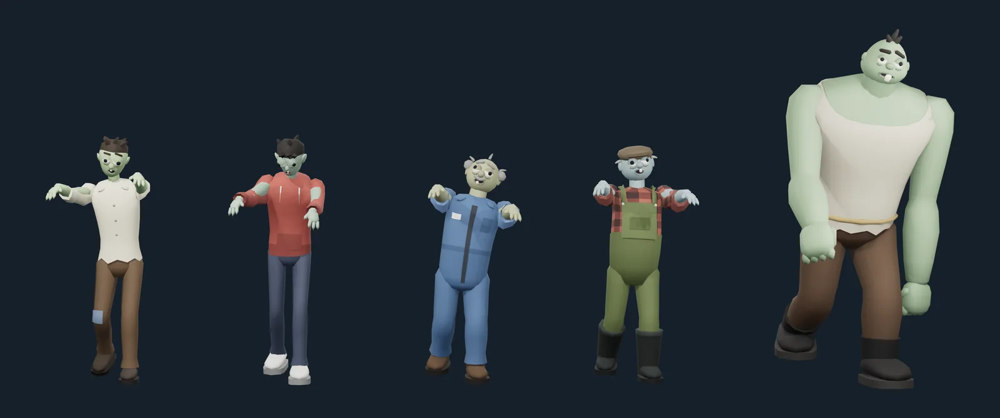

The newest game in Brieltje (November 2026). Zombies come in waves, from every side and always out of sight. Each wave is bigger, a little faster and a little tougher than the last. The waves never end: how far do you get? Play it alone from the menu's Play tab (your best wave is kept), or together when the admin starts it for everyone. Pick where: at home round the house and the bungalow, or by a portal in Smetlede (the church square, or one of three spots along Molenhoek). The game's edge closes round that place while it runs.

- **Five zombies**, our own Blender models, rigged and animated: a thin one in a torn shirt, a teen in a red hoodie, an old mechanic in overalls, a farmer in wellies, and a big one in a white vest. From wave 3 the hoodies sprint. Every fifth wave brings big ones, who stomp and pound the ground round them.
- **No safe room.** Together the houses are open, and the zombies follow you in: up the stairs, onto the roof terrace, through the doors. A shut door holds them for a moment. Whoever perches where no zombie can reach is warned, and then out of the wave.
- **Helping each other up.** A teammate who is down gets up again when you hold Use (E or △) next to them for 3 seconds.
- **Rewards.** Beaten zombies sometimes drop one: a bigger ammo pack, a scope for the rifle and the pistol, or a claymore (hold G or R1 to place it).
- **Stakes.** A big one also drops a bundle of wooden stakes. Hold R (□ on the controller) to plant a row in front of you. Zombies wade through it slowly, and it wears out after about ten of them. A row works best in a gate, a doorway or on a stair. Players on foot can go around either end or cross once the row breaks.
- **Turret.** A big one drops a turret too. Hold E (△) where there is nothing else to use, and it goes up in front of you. It shoots the nearest zombie it can see until its 100 rounds are gone, about half a minute of firing, then folds away. It is a helper, at about a sixth of a rifle's damage.
- **The sniper's double.** One bullet can go through two zombies.
- **Sound.** They groan more often and louder as they come closer, from where they stand. A sprinting runner puffs.
- **Fair.** In multiplayer the server decides every hit, swipe, pickup and help.

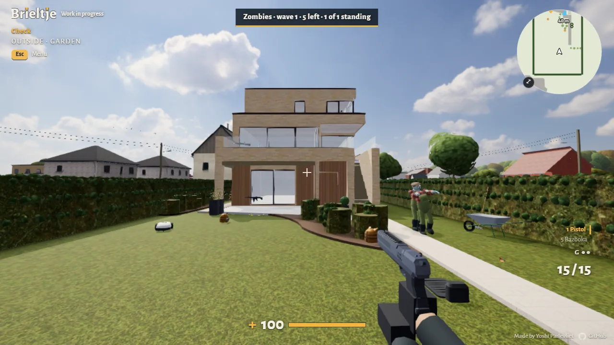

## What's in it

| | |
|---|---|
| **Smetlede** | The village centre as our own Blender models: the Sint-Pharaïldis church, the café beside its tower, the primary school with the chip shop by it, and the houses round the church square. Molenhoek from the church square to its end at Oordegemkouter, on the street as it was rebuilt in 2026, and Kapellenhoek to past Briel: more than 180 houses of our own. At Molenhoek's end you can walk into the end house of the new terrace. The village also includes a custom brick dormer house. You start on the church square, or at another portal of your choice. |
| **Briel** | The hamlet between the fields: the houses along Briel, the bungalow, and the farms and meadows round them. |
| **Everything else** | Built from Flemish open data (GRB, the DHM laser scan, the orthophoto): some 1,200 buildings with their roofs, roads, fields, hedges, trees, poles and ponds, on the real relief. The roads, houses and alleys continue up to about 400 m farther east. Facades follow a Street View survey (used as a reference only). |
| **Our house** | Real scale: walls, stairs, doors and windows. Rooms furnished with our own Blender models. Spawn more with a name in the chat: /sofa, /tesla red, /clown (together when the admin allows it). |
| **Life** | Birds that fly off when you come near, a robot mower doing its rounds, cows and sheep in the meadows, trees in the wind, cars on the roads, and church bells striking the hours. |
| **Getting around** | Walk, sprint, fly, drive a Tesla (with a passenger) or ride a horse. Seven portals jump between our house, the bungalow, the church, the school and three places along Molenhoek. `/location` in the chat, or the menu's Play tab, takes you to any portal or to 33 streets. The map (M, the menu's first tab) gives directions along the roads. |
| **Ways to play** | Explore (just walking around), Paintball (paint guns, for everyone) or Action (a pistol, then a rifle, a shotgun, a sniper rifle and grenades, against each other, giant strongmen and clowns; no shooting on the school grounds). |
| **Together** | Up to 16 players who join with a PIN. Chat, party games (hide and seek, tag, a treasure hunt, Zombies), and house against bungalow. A leaderboard, and a scoreboard to project at a meetup. |
| **Anywhere** | Graphics presets with auto-detection, keyboard and mouse, controller, or touch. In English or Dutch (Nederlands), chosen on the start screen or in the settings. Key hints follow an AZERTY or QWERTY keyboard. |

## Screenshots

| | |
|---|---|
| 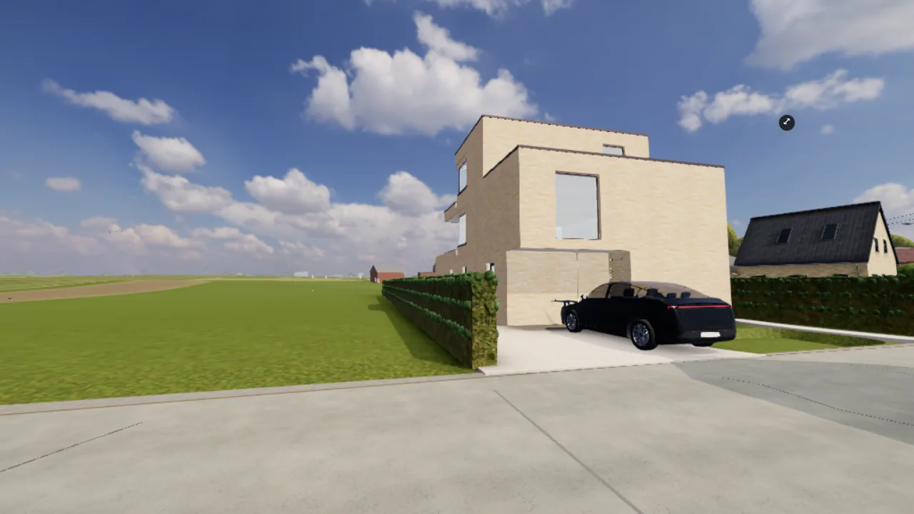 | 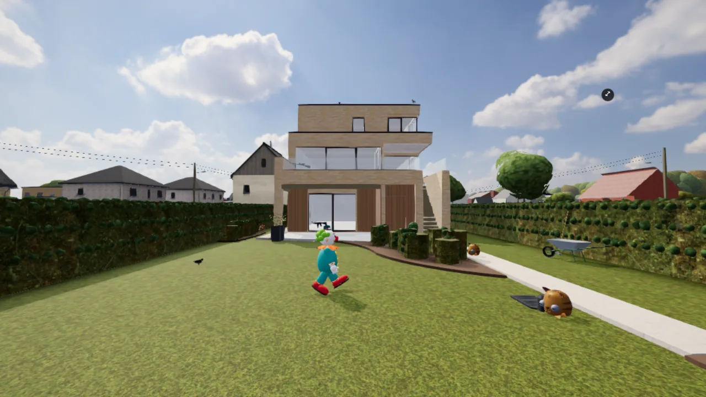 |
| The house from the lane | The back garden, with the robot mower doing its rounds |
| 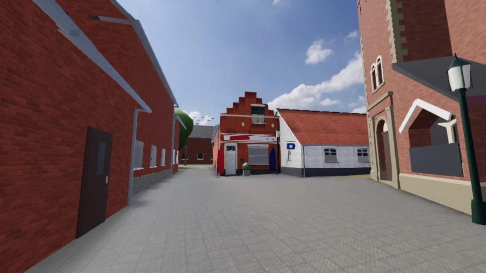 | 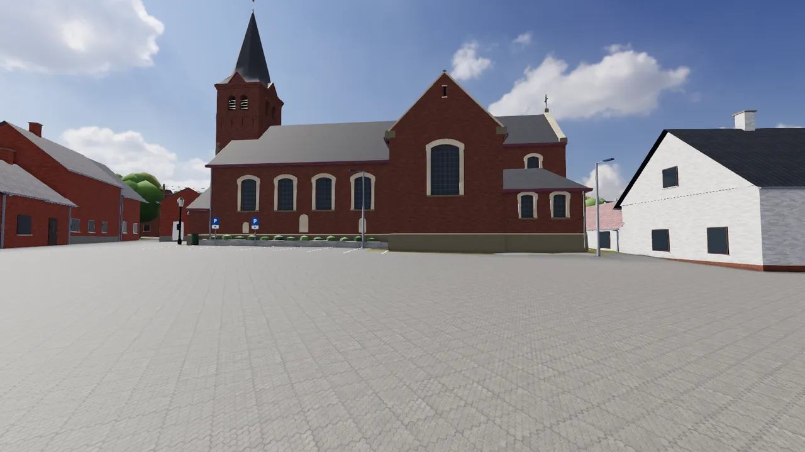 |
| The café beside the church tower | The church of Smetlede from its square |
| 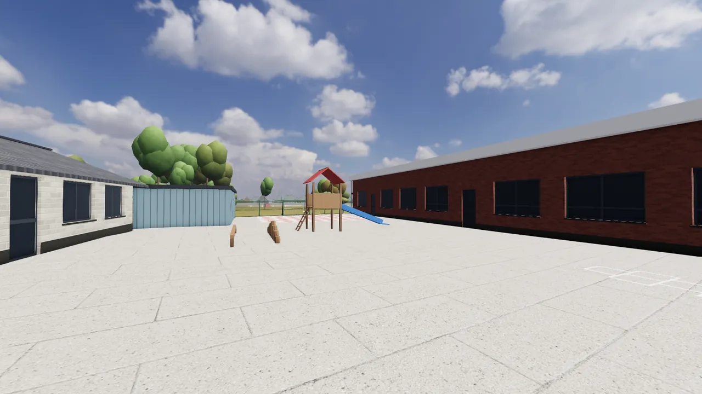 | 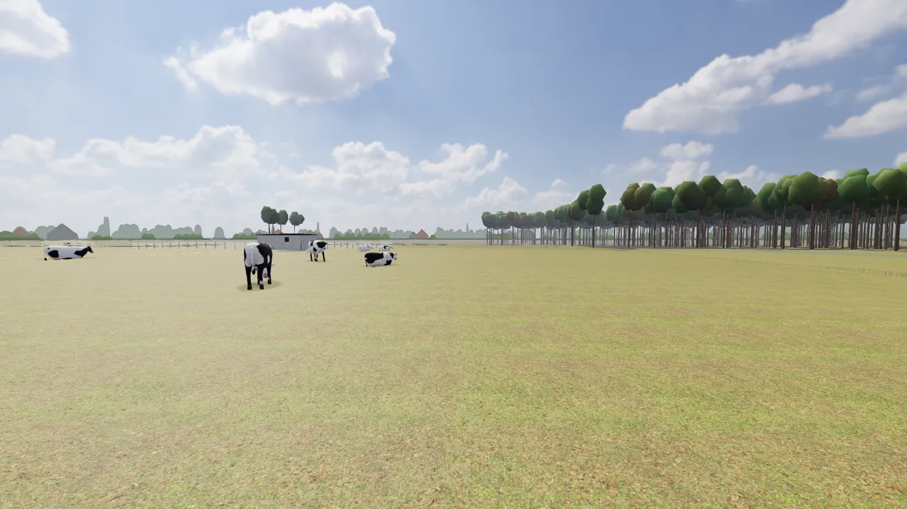 |
| The primary school's playground, with covered bike stands by the gate | Cows in the meadows round the house |
| 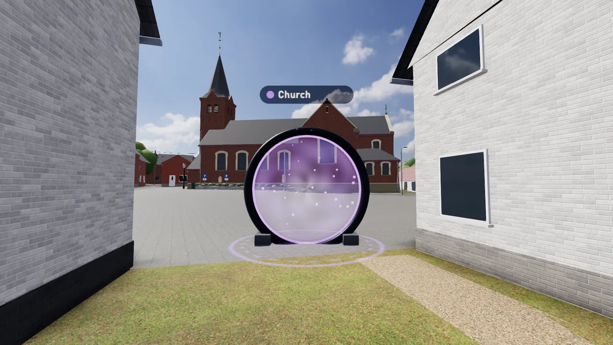 | 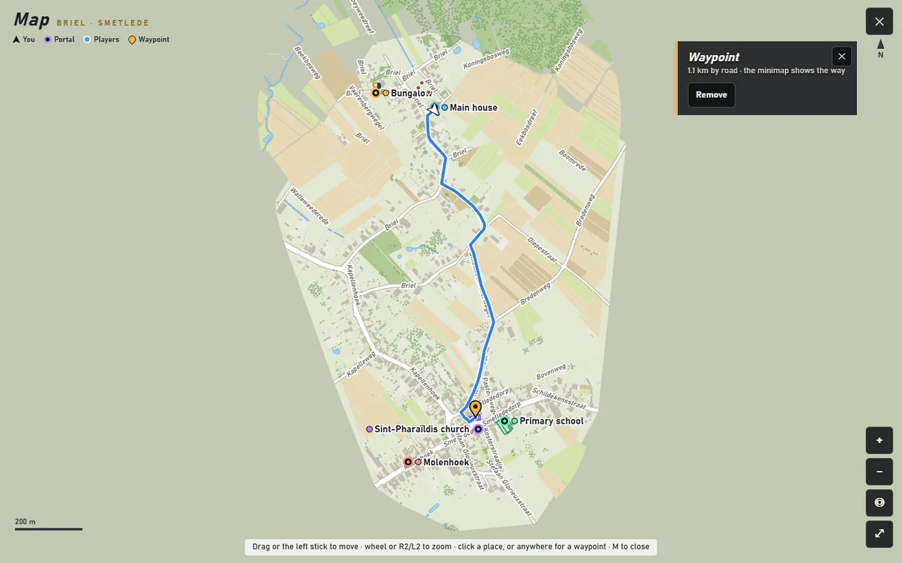 |
| A portal on the church square | The map, the menu's first tab: Smetlede round the church |
| 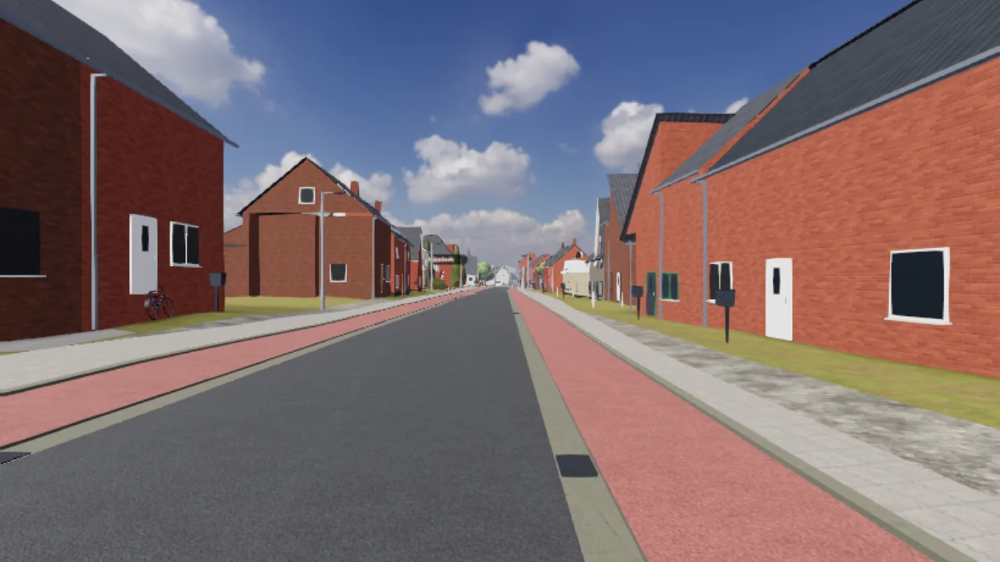 | 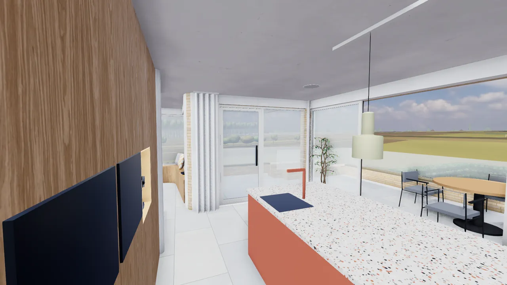 |
| Molenhoek, rebuilt in 2026 | The kitchen and dining corner of our house |
| 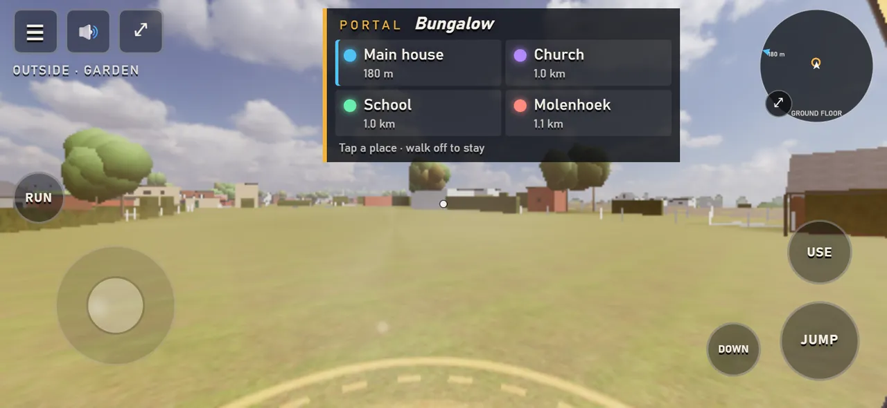 | |
| On a phone, at a portal | |

## Controls

| Action | DualSense | Keyboard and mouse |
|---|---|---|
| Move, look | Left stick, right stick | W A S D (Z Q S D on AZERTY), mouse |
| Sprint, jump | L3, ✕ | Shift, Space |
| Fly up / down | Hold ✕ / ○ | Hold Space / C |
| Use (doors, cars, horses, portals) | △ | E |
| Map (the menu's first tab) | Press the touchpad | M |
| Shoot, aim (Action, Paintball) | R2, L2 | Left click, right click |
| Throw a grenade; hold to place a claymore (Zombies) | R1 | G |
| Reload; hold to plant a row of stakes (Zombies) | □ | R |
| Set up a turret (Zombies) | Hold △ | Hold E |
| Help a teammate up (Zombies) | Hold △ for 3 s | Hold E for 3 s |
| Menu | Options | Esc |

Every control is listed in the game's menu (Controls), and in [docs/DETAILS.md](docs/DETAILS.md).

## Run it yourself

You need Node.js 22 or newer.

```
cd web
npm install
npm run dev
```

Open http://localhost:5173. That's solo play. For multiplayer, build and start the server with an admin password of your own:

```
npm run build
ADMIN_PASSWORD=choose-one npm start
```

It listens on http://localhost:8080. Without `DATABASE_URL` (Postgres) it keeps its players in `web/.data/`.

## How it's made

- **The game:** Three.js (WebGL) in TypeScript, built with Vite. A small Node server with WebSockets runs multiplayer, and the server checks every move, shot and trip. In Zombies it also runs the horde: a grid of the ground and the houses' floors, a distance field the zombies walk down, and every hit and swipe.
- **The world's data:** Python and Blender scripts in [`tools/`](tools) turn the open data and our own measurements into `web/src/data/*.json` and `web/public/models/*.glb`. Private source files are not in this repository; what the game needs is already built.
- **Performance:** the graphics chip is the limit, so most things are instanced, animated in shaders and hidden beyond a draw distance. On the development PC a frame takes about 10 to 15 ms at Medium.
- **Security:** scrypt password hashes, `__Host-` cookies, same-origin checks, rate limits, and the server deciding every hit and trip. Cloudflare sits in front.
- **More:** [docs/DETAILS.md](docs/DETAILS.md) (features in depth, hosting, rebuilding the data, the folders), [DECISIONS.md](DECISIONS.md) (every decision and why) and [PROGRESS.md](PROGRESS.md).

## Contributing

Contributions are welcome. Bug reports, fixes, performance work, accessibility, translations and new details of the villages all help. Open an issue first for anything big. Only Yoshi merges, after a review. `main` goes live on brieltje.be.

Read [CONTRIBUTING.md](CONTRIBUTING.md) before you start. It has the setup, the checks and the rules on privacy, assets and security.

## Licence

© 2026 Yoshi Parlevliet. This project is licensed under [Creative Commons Attribution-NonCommercial 4.0](LICENSE) (CC BY-NC 4.0).

- **You may** use, copy, share and adapt it, for any non-commercial purpose.
- **You must** credit Yoshi Parlevliet, with a link to this repository, and say if you changed it.
- **Commercial use** needs written permission.

Playing on brieltje.be is subject to the [terms of use](https://brieltje.be/legal/terms.html) and the [privacy policy](https://brieltje.be/legal/privacy.html) of Yoshi Parlevliet CommV (contact: yoshi@olive-security.be).

Third-party assets keep their own licences: the textures, sky and characters are CC0, and the map data is © Digitaal Vlaanderen under its free reuse licence. See [docs/CREDITS.md](docs/CREDITS.md).
