# Brieltje

Smetlede and Briel in 3D: a walkable model of the village of Smetlede (Lede, Belgium) and the hamlet of Briel, from the church square and the school to Molenhoek, the fields and our own house. It runs in the browser: explore it alone, or with friends in multiplayer. It is a work in progress, and more of the village is added all the time.

**Play it at [brieltje.be](https://brieltje.be).** Fancy playing together in person, or having your own house in the game? [Let us know](https://brieltje.be/interested). Best on a laptop or desktop with a keyboard and mouse or a PS5 DualSense. Phones and tablets get touch controls. brieltje.be is open to visitors in Belgium only. To play from elsewhere, email yoshi@olive-security.be, or run it yourself (below).

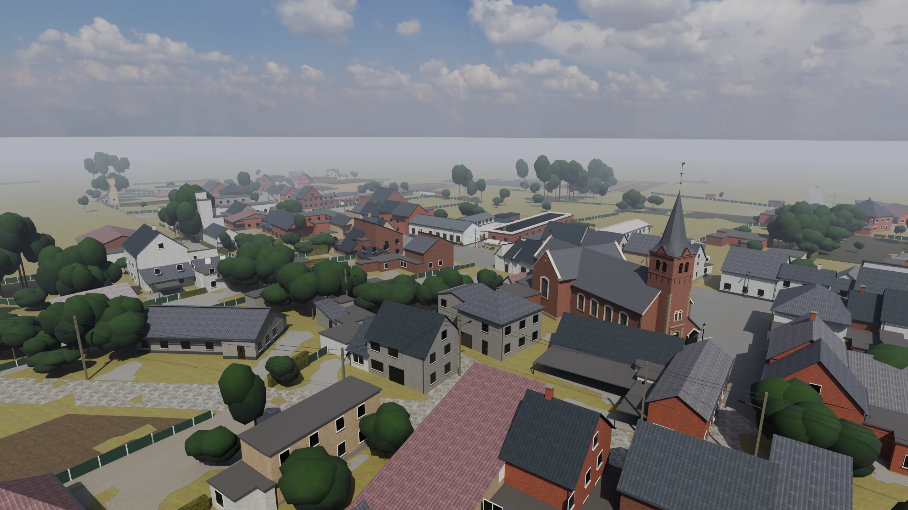

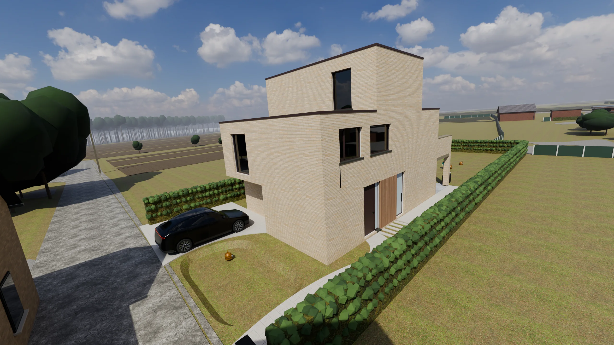

The whole project was made with AI. Yoshi Parlevliet, a cybersecurity consultant rather than a game developer, directed it, and [Claude Code](https://claude.com/claude-code) wrote the game, the data tools and the Blender scripts. Every choice and the reason for it is in [DECISIONS.md](DECISIONS.md).

## What's in it

| | |
|---|---|
| **Smetlede** | The village centre as our own Blender models: the Sint-Pharaïldis church, the café beside its tower, the primary school, and some 27 houses round the church square and along the streets to the school. Molenhoek with its houses and the street as it was rebuilt in 2026. You start on the church square. |
| **Briel** | The hamlet between the fields: the houses along Briel, the bungalow, and the farms and meadows round them. |
| **Everything else** | Built from Flemish open data (GRB, the DHM laser scan, the orthophoto): some 800 buildings with their roofs, roads, fields, hedges, trees, poles and ponds, on the real relief. Facades follow a Street View survey (used as a reference only). |
| **Our house** | Real scale: walls, stairs, doors and windows. Rooms furnished with our own Blender models, and a furniture planner to rearrange them. |
| **Life** | Birds that fly off when you come near, a robot mower doing its rounds, cows and sheep in the meadows, trees in the wind, cars on the roads, and church bells striking the hours. |
| **Getting around** | Walk, sprint, fly, drive a Tesla (with a passenger) or ride a horse. Pick where you start: one of five portals, which also jump between our house, the bungalow, the church, the school and Molenhoek. The map (M, the menu's first tab) gives directions along the roads. |
| **Together** | Up to 16 players who join with a PIN. Chat, party games (hide and seek, tag, a treasure hunt), house against bungalow, and an Action mode with weapons, grenades and giant strongmen (no shooting on the school grounds). A leaderboard, and a scoreboard to project at a meetup. |
| **Anywhere** | Graphics presets with auto-detection, keyboard and mouse, controller, or touch. In English or Dutch (Nederlands), chosen on the start screen or in the settings. Key hints follow an AZERTY or QWERTY keyboard. |

## Screenshots

| | |
|---|---|
| 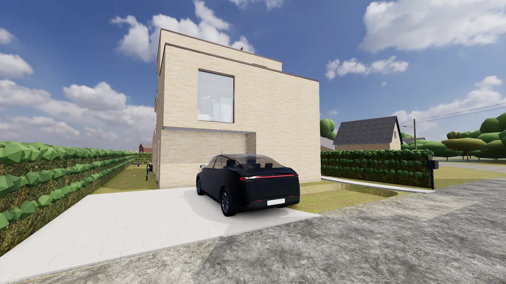 | 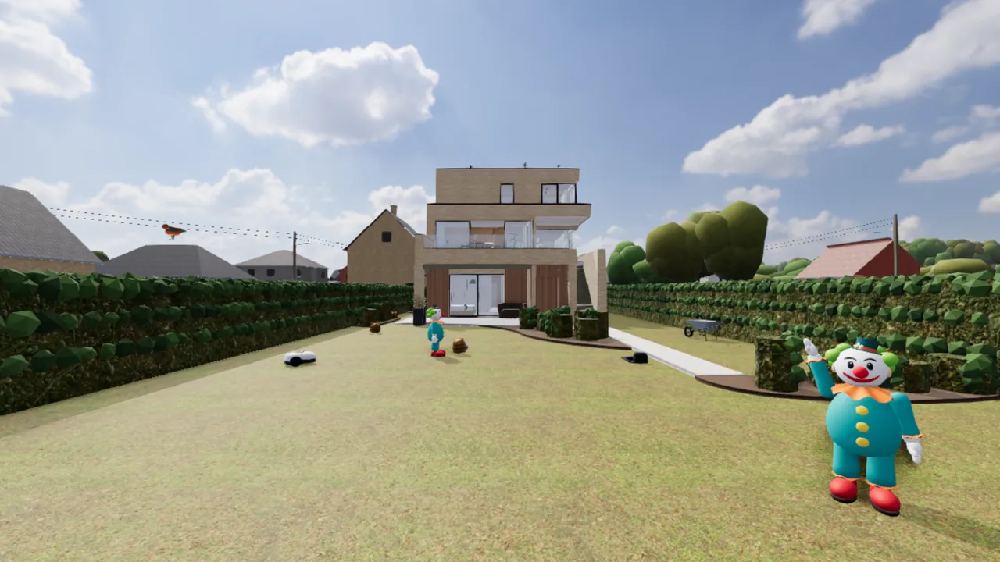 |
| The house from the lane | The back garden, with the robot mower doing its rounds |
| 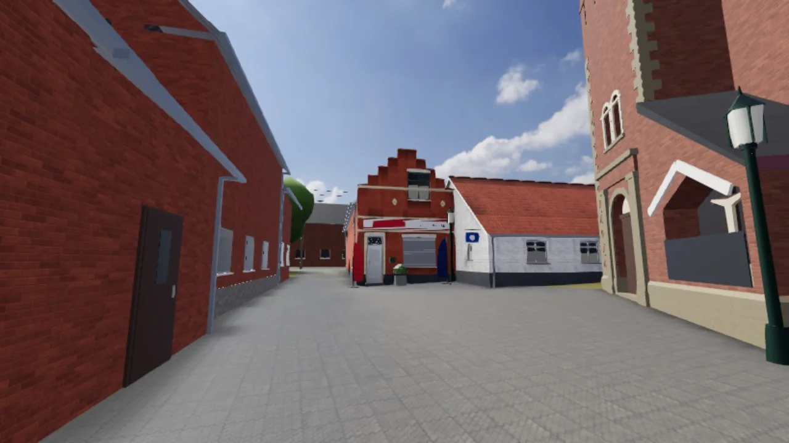 | 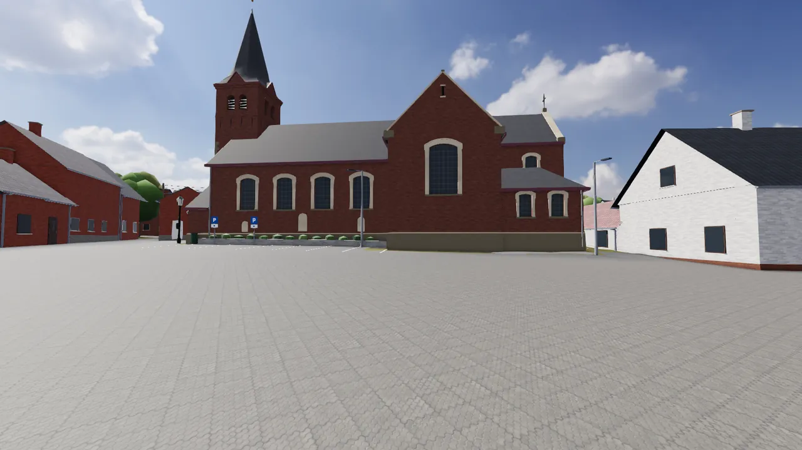 |
| The café beside the church tower | The church of Smetlede from its square |
| 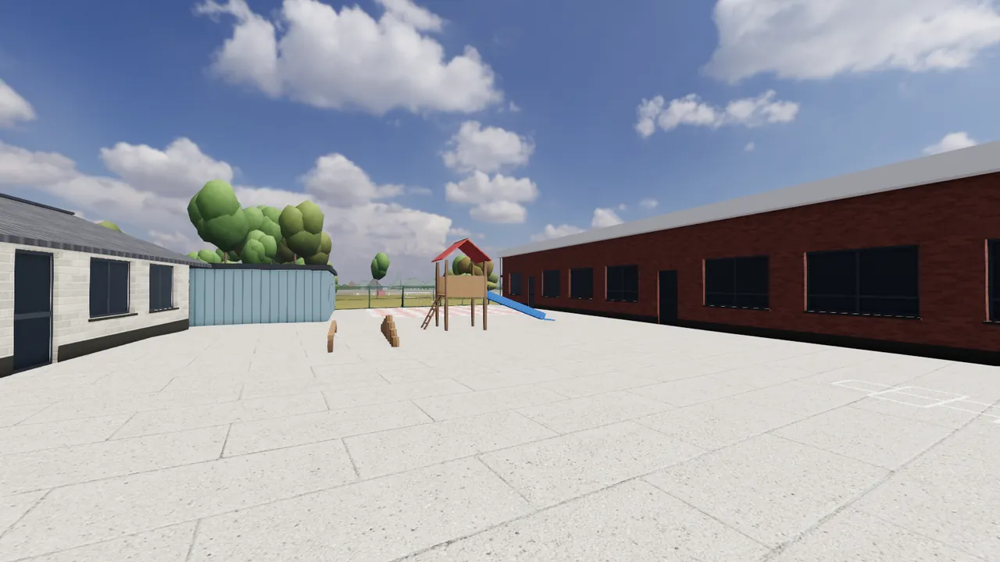 | 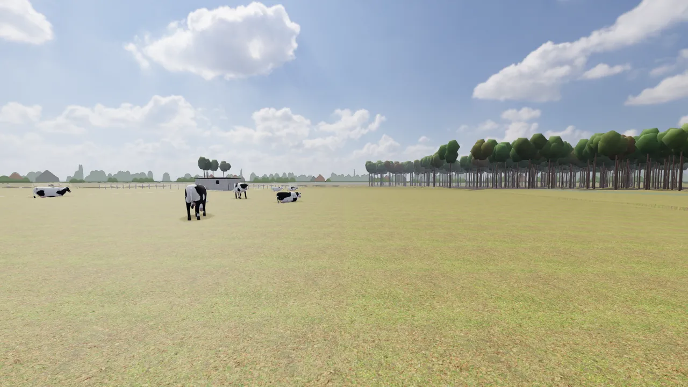 |
| The primary school's playground | Cows in the meadows round the house |
| 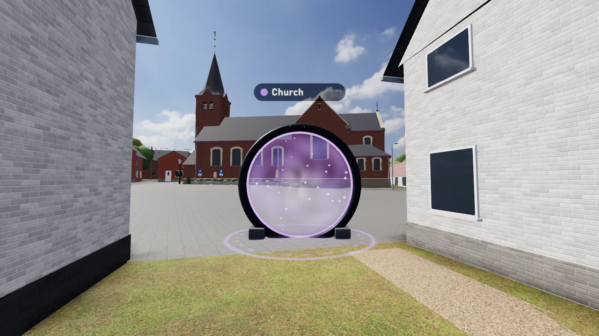 | 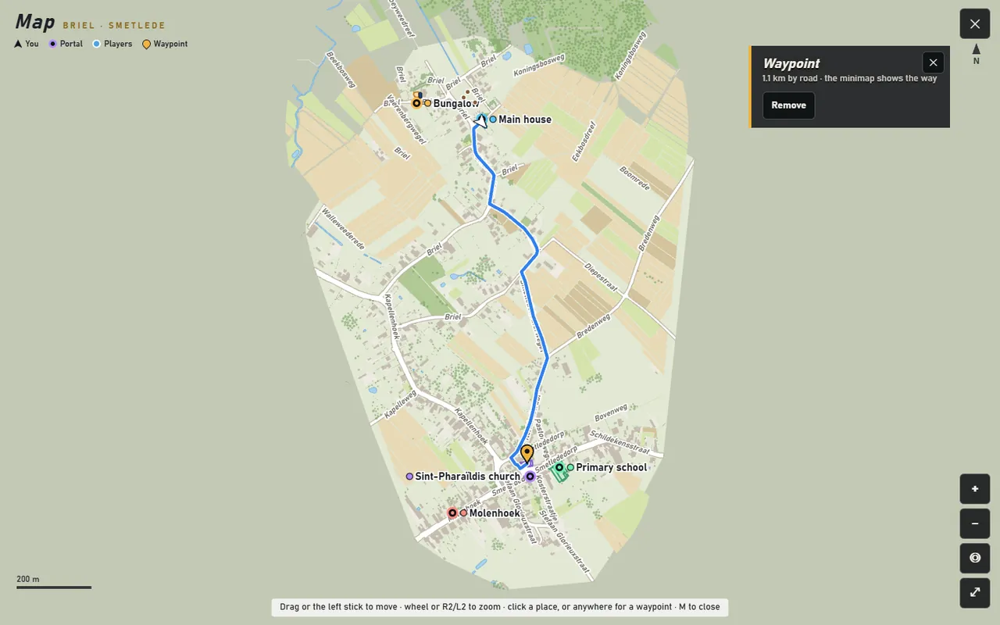 |
| A portal on the church square | The map, the menu's first tab: Smetlede round the church |
| 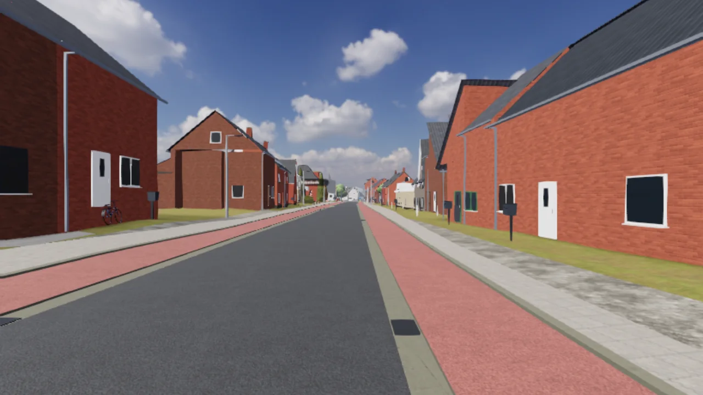 | 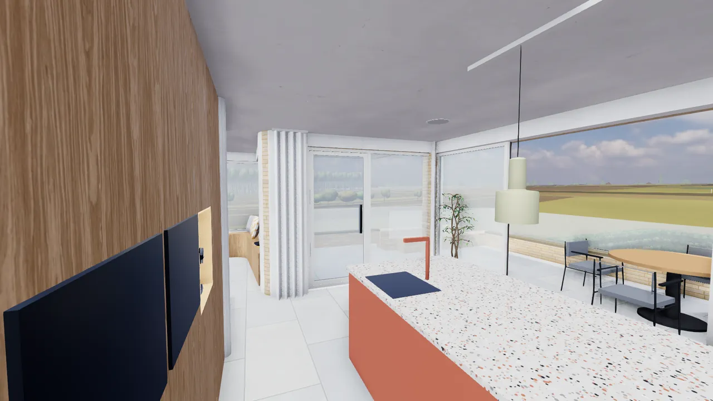 |
| Molenhoek, rebuilt in 2026 | The kitchen and dining corner of our house |
| 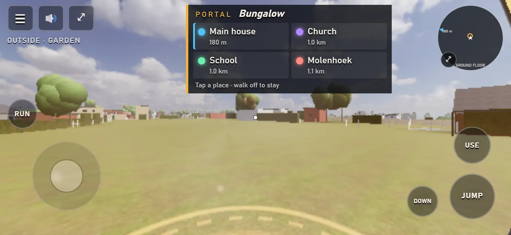 | |
| On a phone, at a portal | |

## Controls

| Action | DualSense | Keyboard and mouse |
|---|---|---|
| Move, look | Left stick, right stick | W A S D (Z Q S D on AZERTY), mouse |
| Sprint, jump | L3, ✕ | Shift, Space |
| Fly up / down | Hold ✕ / ○ | Hold Space / C |
| Use (doors, cars, horses, portals) | △ | E |
| Map (the menu's first tab) | Press the touchpad | M |
| Shoot, aim (Action mode) | R2, L2 | Left click, right click |
| Menu | Options | Esc |

Every control is listed in the game's menu (Controls), and in [docs/DETAILS.md](docs/DETAILS.md).

## Run it yourself

You need Node.js 22 or newer.

```
cd web
npm install
npm run dev
```

Open http://localhost:5173. That's solo play. For multiplayer, build and start the server with an admin password of your own:

```
npm run build
ADMIN_PASSWORD=choose-one npm start
```

It listens on http://localhost:8080. Without `DATABASE_URL` (Postgres) it keeps its players in `web/.data/`.

## How it's made

- **The game:** Three.js (WebGL) in TypeScript, built with Vite. A small Node server with WebSockets runs multiplayer, and the server checks every move, shot and trip.
- **The world's data:** Python and Blender scripts in [`tools/`](tools) turn the open data and our own measurements into `web/src/data/*.json` and `web/public/models/*.glb`. Private source files are not in this repository; what the game needs is already built.
- **Performance:** the graphics chip is the limit, so most things are instanced, animated in shaders and hidden beyond a draw distance. On the development PC a frame takes about 10 to 15 ms at Medium.
- **Security:** scrypt password hashes, `__Host-` cookies, same-origin checks, rate limits, and the server deciding every hit and trip. Cloudflare sits in front.
- **More:** [docs/DETAILS.md](docs/DETAILS.md) (features in depth, hosting, rebuilding the data, the folders), [DECISIONS.md](DECISIONS.md) (every decision and why) and [PROGRESS.md](PROGRESS.md).

## Contributing

Contributions are welcome. Bug reports, fixes, performance work, accessibility, translations and new details of the villages all help. Open an issue first for anything big. Only Yoshi merges, after a review. `main` goes live on brieltje.be.

Read [CONTRIBUTING.md](CONTRIBUTING.md) before you start. It has the setup, the checks and the rules on privacy, assets and security.

## Licence

© 2026 Yoshi Parlevliet. This project is licensed under [Creative Commons Attribution-NonCommercial 4.0](LICENSE) (CC BY-NC 4.0).

- **You may** use, copy, share and adapt it, for any non-commercial purpose.
- **You must** credit Yoshi Parlevliet, with a link to this repository, and say if you changed it.
- **Commercial use** needs written permission.

Playing on brieltje.be is subject to the [terms of use](https://brieltje.be/legal/terms.html) and the [privacy policy](https://brieltje.be/legal/privacy.html) of Yoshi Parlevliet CommV (contact: yoshi@olive-security.be).

Third-party assets keep their own licences: the textures, sky and characters are CC0, and the map data is © Digitaal Vlaanderen under its free reuse licence. See [docs/CREDITS.md](docs/CREDITS.md).
