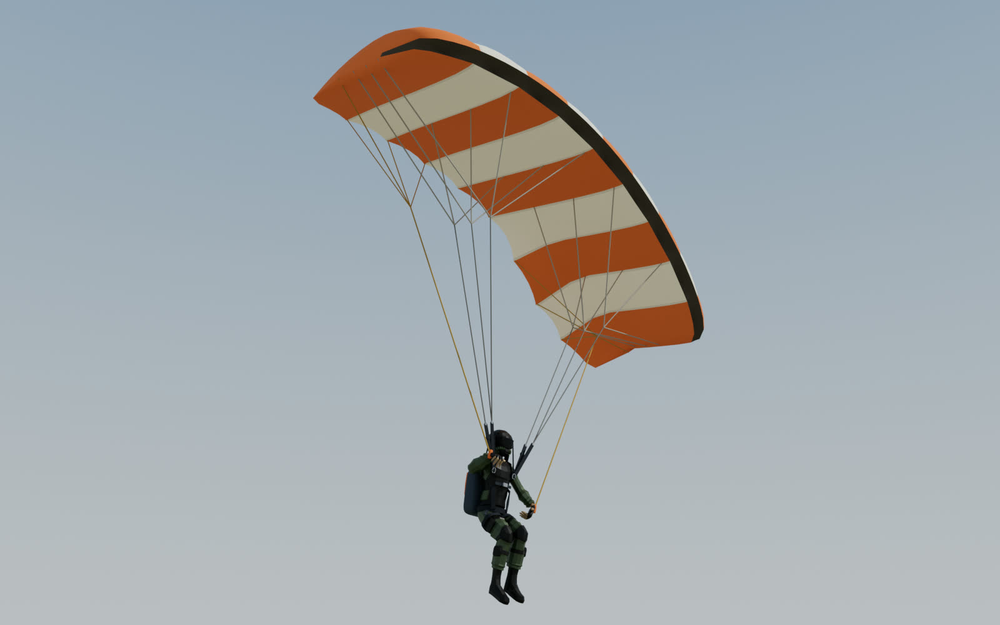
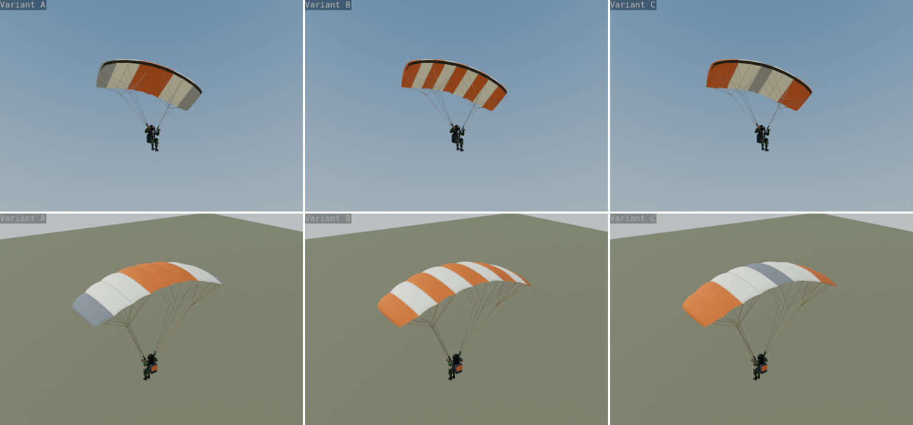
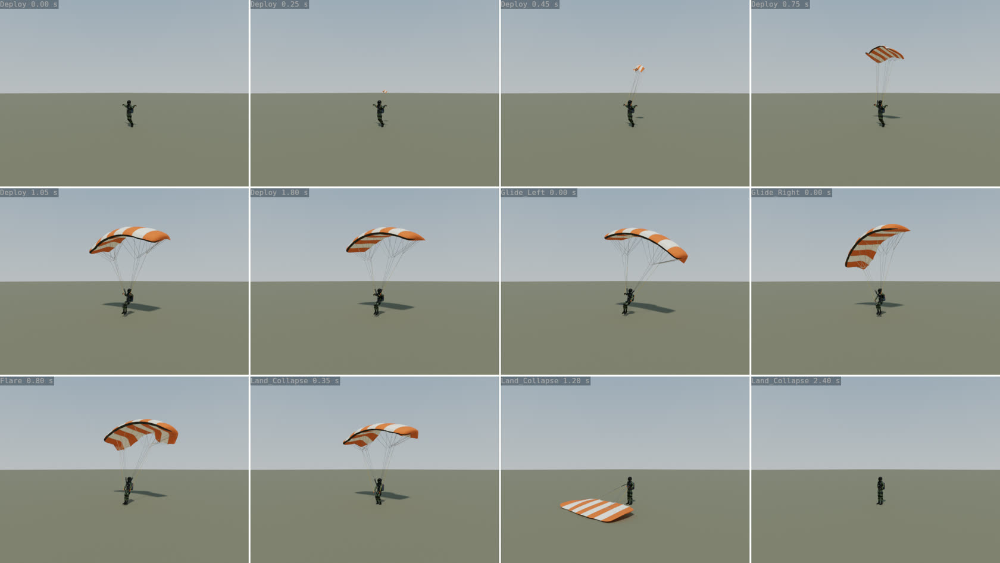
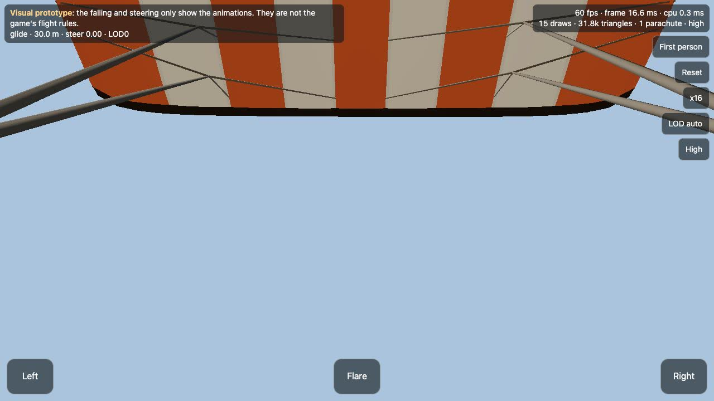
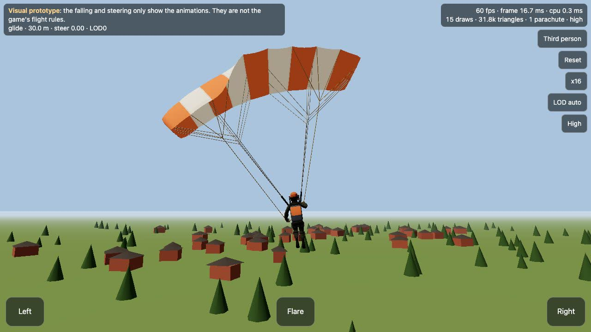
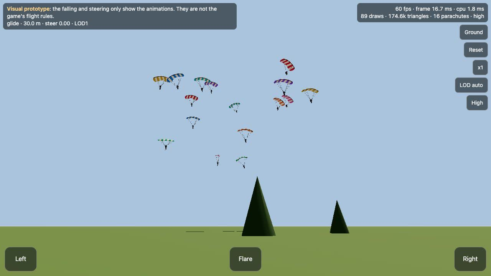
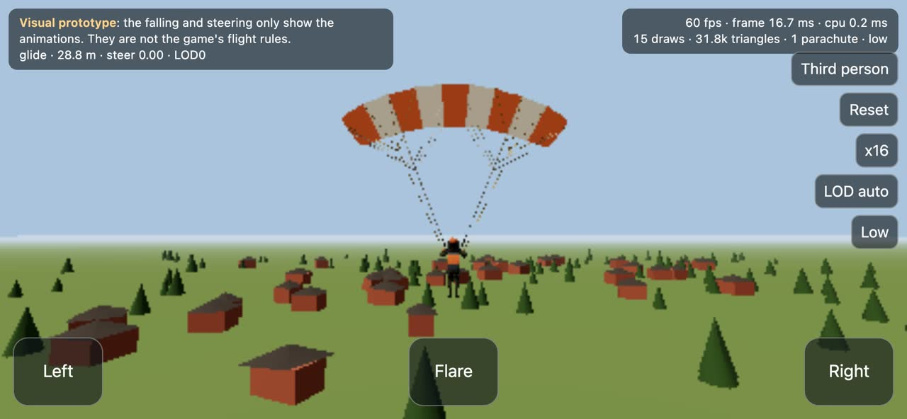
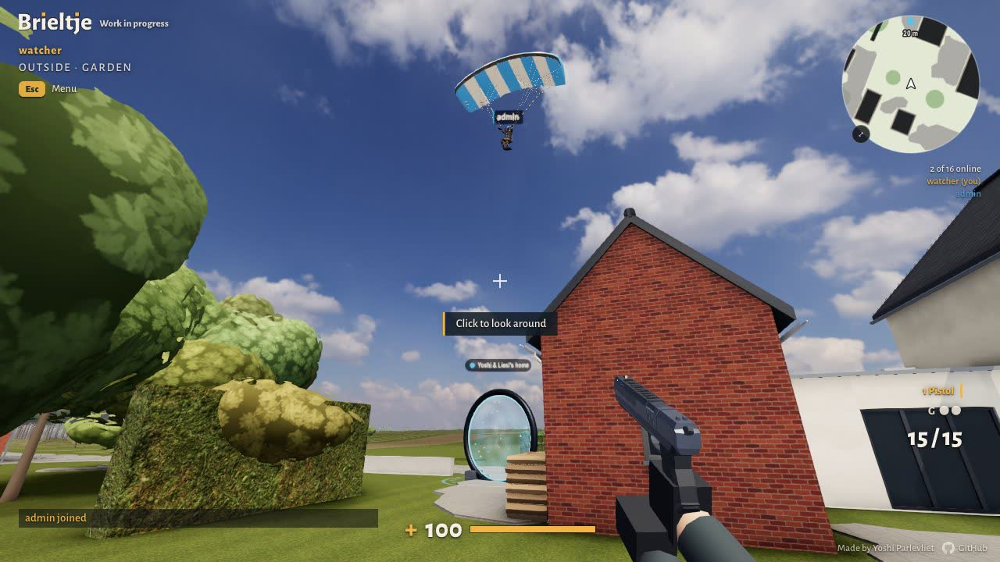
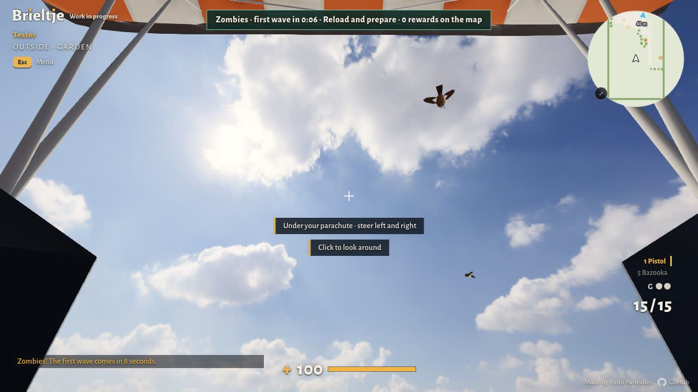

# Parachute arrival

A steerable parachute for arriving on the map by air: on the first arrival and on eligible respawns.
This folder holds the assets, their animation and an isolated preview, and since the gameplay work
(see [In the game](#in-the-game)) how the game uses them.



## What is in it

| File | What it is |
|---|---|
| `web/public/models/parachute.glb` | The runtime asset: canopy, lines, risers, toggles, harness and pack, rigged, six clips, LOD0 and LOD1 |
| `tools/parachute/parachute.py` | The Blender generator: builds, rigs, animates, checks, exports, writes the manifest |
| `tools/parachute/renders.py` | The review renders (imported by the generator) |
| `docs/parachute/manifest.json` | Generated: exported node names and transforms, materials, clips, bounds, budgets |
| `web/parachute-preview.html`, `web/src/dev/parachutePreview.ts` | The separate preview page (dev server only) |
| `web/src/world/parachutePilot.ts` | Pose adapter: the game's figure on the parachute's guides (the game and the preview) |
| `docs/parachute/*.jpg`, `turntable.mp4` | Review images |

`web/public/` is copied into the build, so the GLB ships with the game but nothing loads it yet
(0.13 MB over the wire if something does). The figure is not in the GLB. The preview and the renders use the game's own `swat.glb` (Quaternius,
CC0, already in `docs/CREDITS.md`). Everything else is our own work, made for Brieltje, with no brand
marks, so no new credits are needed.

## Design

A soft rectangular ram-air canopy of nine inflated cells, cream with every other cell in the player's
colour. Cascaded suspension lines, two risers per side, steering toggles in the player's colour, a
harness fitted to the players' figure, and a slate pack with a flap in the player's colour.

| Measure | Value |
|---|---|
| Span, flat / seen from below | 6.00 m / 5.70 m |
| Tips lower than the centre | 0.81 m |
| Chord, centre / tip | 2.45 m / 0.77 m |
| Thickness | 0.42 m, 17 % of the chord |
| Canopy pivot over the foot origin | 5.50 m |
| Riser length | 0.48 m |
| Trim | 7° nose down |

Three colourings were rendered from below and from above (`variants.jpg`): A, a centre band with slate
tips; B, alternate cells; C, coloured tips with a slate centre. B was chosen. Its five coloured cells
include both tips, so the player's colour reads from the ground, from above and from behind at any
bank angle, and it needs no third fabric colour.



## Reproduce

Blender 5.2.3 LTS, from the repository root. The generator needs only Blender's own Python and numpy.

```
blender -b -P tools/parachute/parachute.py --
```

That writes `web/public/models/parachute.glb` and `docs/parachute/manifest.json` (about 5 s).
Options:

```
blender -b -P tools/parachute/parachute.py -- --blend <file.blend>              # also an editable .blend (about 0.6 MB)
blender -b -P tools/parachute/parachute.py -- --renders <dir> --samples 96 --turntable
blender -b -P tools/parachute/parachute.py -- --variants <dir>                  # the three colourings only
```

`--out`, `--manifest` and `--avatar` change the paths, and `--variant A|B|C` the colouring (B).
The editable `.blend` is not committed: the command above makes the same file.

Renders: Cycles on the GPU (Metal here), ACES 1.3 view like the game, 96 samples for the beauty shot,
32 for the views, 24 for the contact sheet and the LODs, 16 for the turntable, OpenImageDenoise on.
Tiles are put together with ffmpeg. All renders with the turntable take about 4 minutes on an Apple M5 Pro.

## Conventions

- Metres. glTF Y up. **Forward is -Z**, right is +X: the same as the game's figures (`Body` in
  `net/swat.ts`), so the parachute goes on the same spot as `Body.root` without a turn.
- `ParachuteRoot` is the pilot's **foot origin**: where the feet stand. The game puts it at the
  player's feet. In flight the legs are bent, so the feet hang 0.2 to 0.4 m above it.
- Unit scale everywhere. `ParachuteRoot` and `Parachute_Rig` are identity transforms. The exporter
  turns the `Root` joint -90° about X; joint transforms below it are in Blender's axes. Use world
  positions (`getWorldPosition`) rather than reading joint transforms by hand.
- three.js keeps underscores in names, so `getObjectByName('Grip_L')` works. It drops dots, which is
  why no name here has one.
- Two skinned meshes share one skeleton: `Parachute_LOD0` and `Parachute_LOD1`. Show one of them.
  GLTFLoader loads each as a group of one skinned mesh per material.
- Clone with `SkeletonUtils.clone`, as the game does for figures: each copy gets its own bones and
  animation state, geometry and materials stay shared.
- A skinned mesh is culled by its rest pose unless told otherwise. Set its bounding sphere from the
  clips' reach (below), as `swat.ts` does for figures.

## Nodes

Rest positions in `ParachuteRoot`'s space (glTF axes, m). The manifest has every exported joint's own
translation, rotation and scale and its index.

| Node | Rest position | Use |
|---|---|---|
| `ParachuteRoot` | 0, 0, 0 | The foot origin. Place and turn this. |
| `Pilot` | 0, 0.858, -0.026 | The pelvis: attachment for the pilot and the harness. The figure's pelvis follows it. |
| `Grip_L` / `Grip_R` | -0.285 (L) or 0.285 (R), 1.485, -0.240 | Where the palms go: on the toggles while steering |
| `Toggle_L` / `Toggle_R` | as the grips at rest | The steering toggles |
| `Canopy` | 0, 5.50, 0.15 | The canopy's pivot |
| `RiserFront_X`, `RiserRear_X` | -0.135 (L) or 0.135 (R), 1.36, -0.167 | The connector links on the harness |
| `Thigh_X`, `Shin_X`, `Foot_X` | the figure's hip, knee and foot | Pose guides for the legs; the leg loops ride on the thighs |
| `Elbow_X` | out, back and down from the shoulder | Where the elbows point |
| `Pack`, `Cell_0..8`, `Brake_L`, `Brake_R` | | Inside the rig: the pack, the cells left to right, the trailing edges |

## Materials

Three opaque glTF PBR materials, single-sided, vertex colours, no textures. Roughness 0.82, metallic 0.

| Material | What | Emissive |
|---|---|---|
| `Parachute_Canopy` | The canopy's cream cells | cream × 0.28 |
| `Parachute_Accent` | Coloured cells, toggles, pack flap | **the player's colour × 0.28** |
| `Parachute_Gear` | Lines, risers, harness, pack, cell mouths | none |

**The player's colour:** clone `Parachute_Accent` once per colour, set `color` to the player's colour
and `emissive` to the same colour times 0.28. Its vertex colours are white, so nothing else tints it.

The faint emissive stands in for light coming through the fabric. Without it the underside, which the
pilot sees when looking up, is lit only by the hemisphere light's ground colour and looks muddy.
It is a constant (no textures, no extra pass) and far below the half-float limit.

## Clips

All six are whole poses (not additive), in place: `Root` never moves, and travel and descent belong to
the game. Keys at 15 a second.

| Clip | Length | Loop | Starts from | Ends in |
|---|---|---|---|---|
| `Deploy` | 1.8 s | once, clamp | packed (everything in the pack, arms out) | exactly `Glide_Idle` at 0 s |
| `Glide_Idle` | 3.0 s | repeat | | the same pose (seam 0 mm) |
| `Glide_Left` | 3.0 s | repeat | | the same pose (seam 0 mm) |
| `Glide_Right` | 3.0 s | repeat | | the same pose (seam 0 mm) |
| `Flare` | 0.8 s | once, clamp | `Glide_Idle` at 0 s | both toggles down, canopy pitched up, legs ready |
| `Land_Collapse` | 2.4 s | once, clamp | `Flare`'s end | standing, all stowed (`Deploy` at 0 s, arms down) |

- **Deploy:** the pack opens, the bag goes out behind and up (0.4 s), the lines stretch and the canopy
  spreads (0.75 s), it inflates with a surge (1.05 s) and settles. The hands take the toggles at about
  1 s.
- **Steering:** play the three glide clips together at one time, weighted by the steering input
  s from -1 (left) to 1 (right): `Glide_Idle` 1 - |s|, `Glide_Left` max(0, -s), `Glide_Right`
  max(0, s). They move in step, so any blend is a clean pose. Full left: the left toggle 0.38 m
  down, the left trailing edge 38° down, the canopy banked 19° and the pilot leaning in.
- **Transitions:** Deploy's end is Glide_Idle's start; cross-fade over 0.2 s anyway. Glide to Flare:
  0.2 s. Flare to Land_Collapse: 0.12 s, on touchdown.
- **Land_Collapse:** the legs reach the ground with a short knee dip, the canopy falls forward onto the
  ground about 3 m in front of the pilot, then it is stowed over the head into the pack (a quick,
  stylised stow). Its lowest point stays 3 cm above the foot origin's ground.



## The pilot

The game's figure keeps its own mesh and skeleton. The parachute carries **pose guides**, and a small
adapter poses the figure on them after the parachute's mixer has run. The preview's adapter is
`web/src/world/parachutePilot.ts`; the renders do the same in Blender (`renders.py`).

| Figure bone (three.js name) | Follows |
|---|---|
| `Body` (pelvis) | `Pilot`'s change from rest; the spine stays at rest above it |
| `UpperLegX`, `LowerLegX` | two-bone IK: the end of the lower leg reaches `Foot_X`, the knee bends towards `Shin_X` |
| `FootX` | `Foot_X`'s change from rest |
| `UpperArmX`, `LowerArmX` | two-bone IK: the wrist reaches 5 cm short of `Grip_X`, the elbow bends towards `Elbow_X` |
| fingers 1 to 3, thumb 1 to 2 | curled round the toggle |
| `Head` | shrunk to nothing for a first-person camera |

The adapter starts from the figure's bind pose (`skeleton.pose()`), not the pose its nodes load in.
It checks that the guides sit on the figure's joints at rest: the preview logs 0.0 mm.

No pilot clips for the figure's skeleton are included. They would only work for `swat.glb`'s bone
names, and the guides keep the parachute independent of the figure. Drop-in compatibility with another
skeleton is not claimed.

One finding while fitting: `net/swat.ts` scales the figure to 1.8 m measured in the pose the file's
nodes load in (1.820 m), not the bind pose (1.852 m), so in the bind pose a figure is 1.83 m tall and
its pelvis is at 0.858 m. The generator computes that scale the same way (0.98922) so the harness fits
the figure as the game draws it.

Hit boxes and collision are not part of this. The parachute is decoration: it has no hit boxes, and the
figure's own hit boxes are not touched by the adapter.

## Bounds and clearance

Everything the clips reach, in `ParachuteRoot`'s space (glTF axes), from every keyed frame of LOD0:

| Clip | min x, y, z | max x, y, z |
|---|---|---|
| `Deploy` | -3.05, 0.76, -1.66 | 2.95, 5.76, 1.57 |
| `Glide_Idle` | -2.95, 0.77, -1.15 | 2.95, 5.76, 1.47 |
| `Glide_Left` | -3.75, 0.77, -1.13 | 1.84, 5.84, 1.64 |
| `Glide_Right` | -1.84, 0.77, -1.12 | 3.74, 5.86, 1.64 |
| `Flare` | -2.86, 0.76, -1.08 | 2.95, 5.75, 2.38 |
| `Land_Collapse` | -2.86, 0.04, -3.99 | 2.95, 5.65, 2.33 |
| All | -3.75, 0.04, -3.99 | 3.74, 5.86, 2.38 |

The figure adds its own 1.8 m below and around `Pilot`. For later checks:

- **Overhead:** keep 6 m clear above the foot origin while gliding (5.86 m plus a margin).
- **Width:** 3.8 m to either side while turning; 3.0 m flying straight.
- **Landing:** the canopy comes down up to 4 m in front of the feet and 0.9 m to the sides of its
  glide footprint. A landing spot needs that patch free of walls, or the canopy goes through them.
- **Lines and the body:** the generator measures the lines against the head (a 14 cm sphere) and the
  chest (17 cm) in every frame once the risers are out. The closest any line comes is 10 cm from the
  head and 10 cm from the chest. Lines are tied to what they hang from, so they never come apart.

## Budgets, measured

| | Target | Measured |
|---|---|---|
| LOD0 triangles | about 6,000 | 5,658 |
| LOD1 triangles | about 1,500 | 1,064 |
| Draw calls per parachute | 2 to 4 | 3 (one per material), plus 3 for its shadow |
| GLB size | below 1.5 MB | 0.60 MB (597,460 bytes), 0.13 MB sent with brotli |
| Textures | at most 1024 px | none |
| Bones | | 31 |

The pilot figure is extra: one draw and one shadow draw, as in the game.

## Tests run

On an Apple M5 Pro (64 GB), macOS, in Chrome for Testing (Playwright's copy, headless, ANGLE on Metal),
against the Vite dev server. No render jobs ran during the timings.
Emulation is not a real phone or iPad: those were not tried.

- `npm run build` in `web/` passes (tsc, then Vite). The preview is not in the build.
- The GLB loads in three.js r186 with all six clips, both LODs and every guide node, and the adapter's
  rest check gives 0.0 mm.
- Loop seams of the three glide clips: 0 mm (measured on the skinned mesh in Blender).
- Touch emulation, 844 × 390 with five touch points, Low: holding Right steers (0.99), releasing goes
  back (0.03), tapping Flare flares, and the parachute lands and stows.
- Low (pixel ratio 0.55, 1024 shadow map) and High, one and sixteen parachutes, alternating in one
  session after a 4 s warm-up:

| View | Preset | 1 parachute | 16 parachutes |
|---|---|---|---|
| Third person, live (most of the 16 out of view) | Low | 0.3 ms CPU, 15 draws | 1.6 to 1.9 ms CPU, 19 draws |
| Ground camera, all 16 in view, frozen pose, no frame cap | Low | 1.27 ms a frame, 15 draws, 23k triangles | 1.69 to 1.72 ms, 89 draws, 175k triangles |
| Same | High | 1.28 to 1.31 ms | 1.69 to 1.78 ms |

  Sixteen parachutes with their figures cost about 0.1 ms of CPU each (mixer and the pilot's IK),
  and about 0.45 ms of frame time in view on this chip. A phone will be several times slower.
- SwiftShader (`--use-angle=swiftshader`), which turns half-float overflow into infinity as Apple's
  chips do: the preview renders normally, nothing turns black.

## The preview

```
cd web
npx vite --port 5274 --strictPort
```

Open `http://localhost:5274/parachute-preview.html`. Left and Right (hold), Flare, Reset; cameras
first person, third person and ground; x16 for sixteen parachutes; LOD auto, 0 or 1; Low or High.
Keys: A or Q and D or the arrows steer, Space flares, R resets, 1 to 3 pick a camera. Drag to look
round. URL options: `?cam=fp|tp|ground`, `?n=16`, `?q=low|high`, `?lod=auto|0|1`,
`?clip=<name>&t=<seconds>` (freeze every parachute), `?pitch=<radians>`, `?hud=0`.

The falling, gliding and steering there are a **visual prototype** for showing the animations: 70 m
start, 0.6 s packed, 8.5 m/s forward, 4.2 m/s down, a flare of its own at 3.2 m, flat ground. They are
not proposed flight rules.

| | |
|---|---|
|  |  |
|  |  |

More renders: `views.jpg` (front, side, rear and underside with a 1.8 m pole), `lods.jpg` (LOD0 and
LOD1 from 25 m), `turntable.mp4`.

## In the game

What the gameplay work built on these assets. The numbers are in `web/shared/parachute.mjs`, shared by
the page and the server.

| Moment | Alone | Together |
|---|---|---|
| First arrival at a start place (the church by default) | by parachute | by parachute: the server answers the start with a drop |
| Starting at the house (no start place) | by parachute, down the lane onto the house's start | by parachute: the page asks (`home`), the server decides |
| Respawn after a death | by parachute (the outside places) | by parachute only onto a place outside; into a room on foot |
| Zombies: the start, the return between waves, joining late | by parachute | by parachute |
| Zombies: a teammate's revive | on foot, where you fell | on foot, where you fell |
| Party games (hide and seek, tag, treasure, teams) | unchanged | unchanged |

- **The drop:** 80 m over the place. First 4 s of free fall, straight down, picking up speed to at most
  14 m/s (the server allows 16). Then the canopy opens (the Deploy clip, 1.8 s): it starts to brake the
  fall 0.55 s in, eased over 1.5 s down to 4.2 m/s, with no jolt, while the forward speed picks up to
  3.2 m/s. A short glide, a flare at 3 m (1.5 m/s forward, 1.2 m/s down), and on your feet. 10.8 s in
  all. Coming down mostly straight keeps the drop close to its place: it starts 13.8 m behind it
  (`DROP.reach`), facing it as a respawn does, so without steering you land on the place the server
  picked (measured: 0.1 m off) and the whole path stays inside a Zombies arena. The canopy is fully
  open about 16 m up; the last stretch comes in at about 50°, clear of the houses round a street.
  `DROP.reach` and `DROP.time` are not typed in: `fly()` in `web/shared/parachute.mjs` flies the drop
  as the page does when the file loads, so the page, the server and the tests always agree.
- **The house's start:** the drop lands on the house's own start in the lane (`HOME_DROP`), coming down
  the lane from the west, facing east (the house on your left), because the houses across the lane are
  in the way of an approach facing the house.
- **Steering:** the left and right movement keys, the left stick or the touch joystick turn you at up
  to 1.1 rad/s, picked up and let go of gently; turning with the mouse turns you too. Forward and back
  nudge the glide by 8 %. No jumping, flying, crouching or shooting; the gun is put away and a hint says
  what is happening (free fall, then steering).
- **Your camera:** it keeps your pitch when the drop begins and eases it: down at the ground in the free
  fall, up at the canopy as it opens, ahead and down to the landing place for the glide, near level for
  the touchdown. Looking round yourself stops that for the rest of the drop. The view rolls into turns
  and swings a little as the canopy opens (two lightly damped springs, a pendulum of 2.4 s), and the
  knees give on touchdown (0.3 m, 0.45 s). Only the camera: where you aim and what others see don't change.
- **The server decides.** It starts every drop (`startDrop` in `web/server/game.mjs`) and keeps the
  player in it until the page says it landed (not in the first 1.2 s, when older messages can still
  come) or 15 s have passed (`DROP.maxMs`, about 4 s more than a drop takes). Across, a drop is slower
  than running, so the movement budget holds it as it is; down, the free fall stays under the 16 m/s
  limit. The house's start (`homeDrop`) is taken once, with the start places, in the first 90 s, alive,
  on foot, and only while the server still has the player within 30 m of it: a drop onto where a fresh
  join already is, never a trip.
- **Combat:** under a parachute a player is calm, as on the school grounds (`calm`): they can't shoot
  and nobody hurts them, zombies and strongmen included. Landing gives the usual 2 s of protection.
- **The others** see a flag in the tick (`FLAG.chute`, bit 8 of a player's flags, above the teleport
  counter, so an older page reads the rest as before) and draw the parachute on the figure in the
  player's colour (`web/src/world/parachutes.ts`), posed by the adapter. In the free fall the figure lies
  face down, arms out (Deploy's first frame), and swings upright as the canopy pulls. Under the canopy it
  swings a little round the canopy: out of a turn and back, and through once after the opening's surge.
  Every change of clip is an eased cross-fade (Deploy to the glides 0.45 s, Flare 0.35 s,
  Land_Collapse 0.3 s), Land_Collapse plays at 0.8 of its speed so the canopy settles softly, the
  figure is handed back to its own animation over 0.7 s after landing, and the pack and harness shrink
  away in the last 0.3 s instead of vanishing. Steering shows from how fast they turn. Someone first seen
  part way down is drawn as far along as their height says (`dropSince`). The figure doesn't blink
  while protected under a parachute.
- **Your own:** drawn over and round you (the pack, leg loops and toggles hidden: nobody is in them).
- **The model** is fetched after the world is in (0.13 MB), before anyone drops.
- **The admin's rule** "Players arrive by parachute" (on by default) turns it all off together.

| | |
|---|---|
|  |  |

How the assets were meant to map to an arrival, as handed over before the gameplay work:

- **First arrival:** place `ParachuteRoot` at the player's feet in the air, play `Deploy` at once (its
  first frame is the packed state) or hold that frame for a short free fall first.
- **Descent:** the game moves and turns `ParachuteRoot`; the glide clips blend by steering input.
- **Steering:** the same input that turns the player drives the three glide weights. The toggle that
  is pulled is the side the player turns to.
- **Landing:** start `Flare` a little before touchdown (the preview uses 3.2 m), then `Land_Collapse`
  on touchdown. Its end is the stowed state, so the parachute can be hidden then.
- **First-person view:** hide the figure's head as the adapter does, and let the player look up: the
  risers and the canopy's underside are above, the centre of the view stays clear.
- **LOD:** LOD1 from about 35 m on Medium and up, and from about 15 m on Low, where LOD0's thin lines
  break up on its coarse pixels.

Respawns that could use it:

- **Multiplayer, after a death:** the server picks the spot (`respawn()` in `web/server/game.mjs`),
  with 2 s of protection. A parachute arrival could start above that spot.
- **Zombies, a teammate's revive:** the player gets up where they fell (`up()` in
  `web/server/zombies.mjs`). That is not an arrival: no parachute.
- **Zombies, between waves:** players who were down come back at the house's outside spots when a
  wave is cleared (`revive()` and `gather()`). That is the eligible Zombies return: they could float
  down onto those spots during the break.
- **Zombies, joining late:** `join()` gathers a player who is outside the edge; also eligible.

## Decisions left for the gameplay work

As listed before the gameplay work; [In the game](#in-the-game) says what was chosen. Still open:
roofs and trees as landing places (the game's ground includes roofs, so a steered drop can land on
one), sounds, and a key to open the parachute early. The list as it was:

- Server-authoritative descent: who moves a falling player, the speeds the server accepts (today it
  caps vertical speed at 16 m/s and height at 120 m over the ground), and what the other players see.
- Where drops start and land, within the map edge, the party edge and the Zombies arena edges.
- Safe landing spots: roofs, trees, water and the canopy's 4 m landing patch.
- Spawn protection while in the air, and when it ends.
- Combat while airborne: whether a player under a canopy can shoot or be hit, and their hit boxes.
- Which respawns use it in Zombies (the between-wave return above), and that revives stay on the ground.
- Whether the first arrival replaces the portal arrival or adds to it, alone and together.
- Sounds, a key or button to open early, and what happens in a car, on a horse or while flying.

## Licence

The parachute, its generator and the preview code are our own work under the project's licence
(CC BY-NC 4.0). The preview and the renders use `swat.glb` by Quaternius (CC0), already credited.
